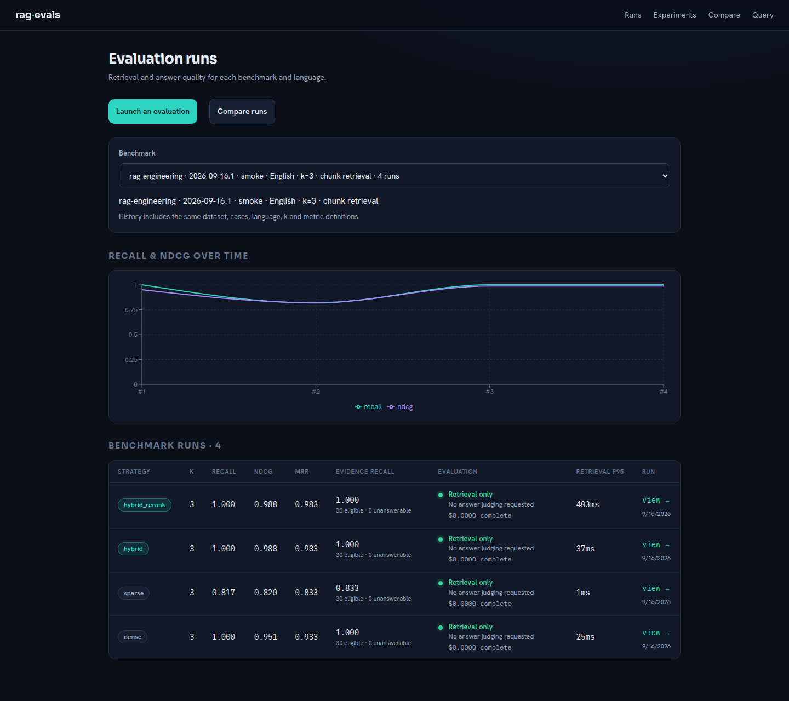
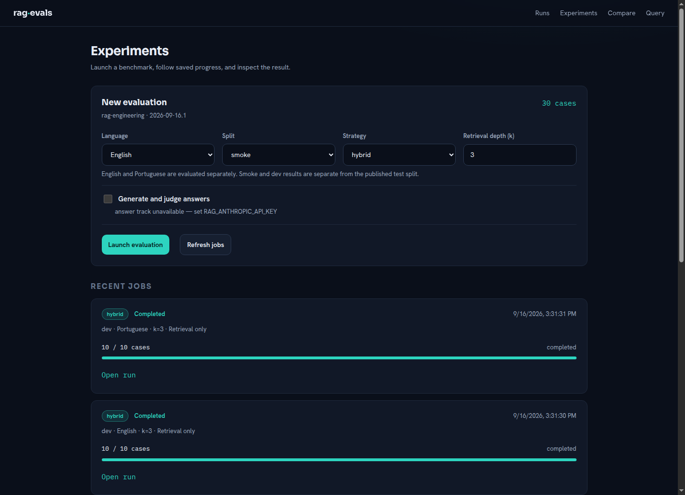
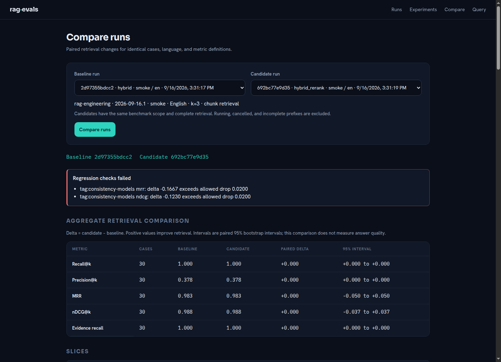
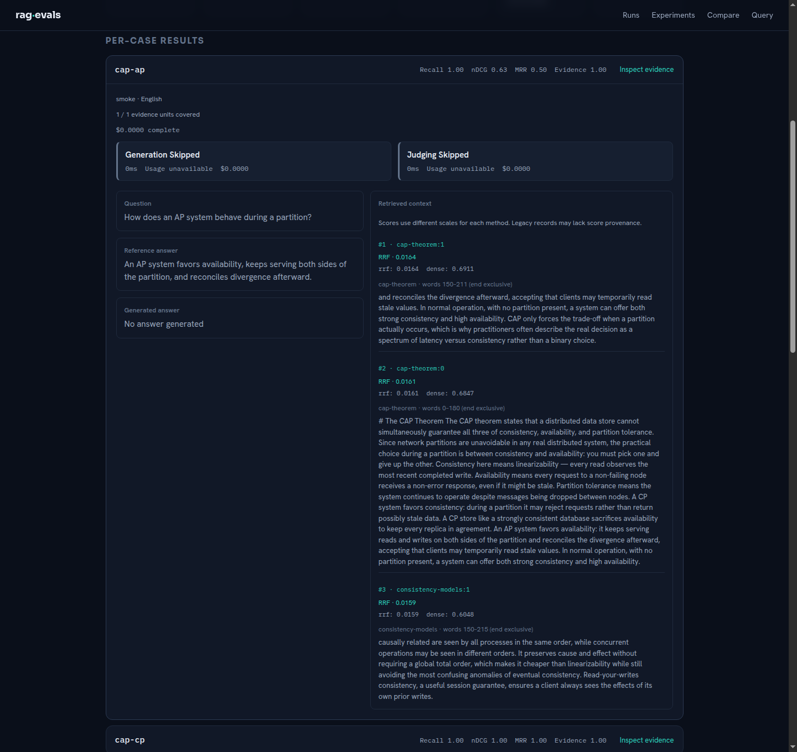

# rag-evals

**A RAG service and experiment dashboard for measuring retrieval, inspecting evidence, and catching regressions before a change ships.**

[](https://github.com/augustoamaro/rag-evals/actions/workflows/ci.yml)
&nbsp;
&nbsp;
&nbsp;

Publish an immutable document index, launch an evaluation, compare it with a
retained baseline, and inspect the cases behind each score. The same evaluation
service powers the CLI, FastAPI and Next.js dashboard. CI checks absolute quality
floors and paired regressions across the full benchmark, slices and critical cases.

**No API key is needed for ingestion, retrieval or retrieval evaluation.** Local
fastembed/ONNX models download on first use and can then run from their cache.
Optional Claude answer generation and LLM judging require
`RAG_ANTHROPIC_API_KEY`; their outcomes, coverage, usage and estimated costs are
recorded separately. Live answer quality and judge calibration remain to be validated.

[Run it](#run-it) · [Dashboard workflow](#dashboard-workflow) ·
[Measured baselines](#measured-baselines) · [Methodology](#eval-methodology) ·
[Roadmap](docs/improvement-roadmap.md)



## Dashboard workflow

- **Launch and follow an experiment.** Select a strategy, split, language and
  retrieval depth. Progress survives reloads; cancellation retains saved work.
- **Compare compatible runs.** Inspect paired metric changes, slice regressions
  and descriptive 95% bootstrap intervals. Incomplete runs stay out of comparisons.
- **Explain a result.** Open a case's reference, retrieved passages, evidence spans
  and actual dense, sparse, RRF or reranker scores. Add run and case review notes.
- **Keep benchmark scopes explicit.** English is the default. Portuguese runs
  separately, and historical indexes retain their datasets and model identities.

<details>
<summary><strong>Experiment launcher and saved progress</strong></summary>



Answer evaluation is optional. Without a provider key, the dashboard explains its
availability while the retrieval workflow remains usable.

</details>

<details>
<summary><strong>Paired comparison and slice regressions</strong></summary>



Equal aggregate scores can hide changed cases. This smoke comparison exposes a
slice regression when comparing hybrid retrieval with hybrid plus reranking.

</details>

<details>
<summary><strong>Stored case evidence</strong></summary>



Stored context records what the evaluation actually retrieved. Review notes are
versioned separately from benchmark labels and results.

</details>

Screenshots show real local retrieval runs over the bundled corpus, with no model
provider calls. [Capture details](docs/media/README.md) identify their scope.

## Measured baselines

The versioned **English smoke benchmark** contains 30 cases over 10 documents
(20 chunks). These **k=3** measurements are retained regression baselines, not a
general retrieval-quality claim:

| Strategy | Recall@3 | nDCG@3 | MRR | Evidence recall |
|---|---:|---:|---:|---:|
| Dense | 1.000 | 0.951 | 0.933 | 1.000 |
| Sparse | 0.817 | 0.820 | 0.833 | 0.833 |
| Hybrid | 1.000 | 0.988 | 0.983 | 1.000 |
| Hybrid + rerank | 1.000 | 0.988 | 0.983 | 1.000 |

The separate **published BEIR/SciFact test profile** covers 5,183 documents and
300 test cases. The fixed, untuned hybrid configuration reached **0.841 document
recall@10** and **0.721 nDCG@10**. Its document labels and metrics differ from the
local chunk benchmark; neither result establishes generated-answer quality.

Ten English and ten Portuguese development probes are evaluated separately.
Their labels have not been independently reviewed, and they share source evidence
with the smoke set. They are diagnostics, not held-out tests.

See the [measurement report](docs/benchmarks-2026-09-16.md),
[seven per-case baseline artifacts](benchmarks/), and
[dataset provenance and format](corpus/README.md) for complete results and limitations.

## Architecture

Dependencies point inward toward a pure domain. The LLM (Anthropic SDK), database
(pgvector/SQL), and embedding model live behind ports in the adapter layer.

```
rag-evals/
├── src/rag/
│   ├── domain/        PURE — entities + Protocol ports (Embedder, Retriever,
│   │                  Generator, Judge, ChunkStore). No I/O, no framework.
│   ├── metrics/       PURE — ranking metrics, evidence span unions, RRF,
│   │                  percentiles. Hand-verified test vectors.
│   ├── chunking/      PURE — deterministic word-windowed chunking.
│   ├── adapters/      INFRA — the only modules with I/O / SDK / SQL:
│   │     embedding/   fastembed (bge-small, 384-dim, local, no key)
│   │     retrieval/   pgvector hybrid (scoped cosine + FTS + RRF + rerank)
│   │     db/          psycopg3, migrations, immutable indexes, eval store
│   │     datasets/    strict YAML and binary BEIR imports
│   │     llm/         Claude generator + judge (the only Anthropic SDK *usage*;
│   │                  composition roots construct the client and inject it)
│   ├── services/      ingestion · query · eval (orchestrate ports)
│   ├── api/           FastAPI (thin routers, dependency-injected)
│   └── cli/           Typer: rag ingest · rag eval [--judge] [--gate]
├── corpus/            bundled docs + benchmark.yaml; legacy golden.yaml fixture
├── benchmarks/        reviewable per-case baseline artifacts
├── migrations/        ordered .sql
└── apps/web/          Next.js dashboard
```

Decisions worth calling out:

- **Local embeddings, optional Claude.** Retrieval and its metrics need no
  provider key. Generation and judging are separate, opt-in stages.
- **Hybrid = pgvector dense + Postgres FTS sparse + RRF.** Real hybrid retrieval
  with **no extra infrastructure** (one Postgres). RRF fuses by rank, so it needs
  no score calibration across the two very different score scales.
- **Stable evidence units.** A local label identifies a document and a word span.
  Evidence recall measures complete coverage by the union of retrieved chunks;
  duplicate overlap copies count once and adjacent pieces can cover one span.
  Published document qrels use document IDs instead of local snippet heuristics.
- **Immutable indexes.** Dataset content, labels, chunking, vectors and the actual
  embedding artifacts identify a published index. Re-ingestion preserves old
  indexes and their self-contained datasets; every retrieval binds to one index.
- **One bounded local worker.** PostgreSQL coordinates job admission and atomic
  stage checkpoints. Retries are idempotent; restart preserves observed results
  without replaying model calls.
- **psycopg3 + explicit SQL over an ORM.** The hybrid-retrieval SQL (pgvector +
  FTS + RRF) is the interesting part — it stays visible.

## Eval methodology

- **Retrieval track (no LLM):** for each selected case, retrieve with a strategy
  (`dense` / `sparse` / `hybrid` / `hybrid_rerank`) and compute **recall@k**,
  **precision@k**, **MRR**, and **nDCG@k**, plus **evidence recall**. Local chunk
  rankings use document-qualified overlap with labeled spans. These chunk metrics
  still depend on chunking; evidence recall has a fixed label denominator.
  BEIR document rankings take the first hit per document from 50 candidate chunks,
  then retain up to k unique documents. Each representative chunk supplies context;
  document qrels do not establish passage-level or answer correctness.
- **Selection and slices:** one split and one language per run, English by default.
  Tag slices and eligible-case counts accompany the aggregate. Cases with no
  positive evidence are excluded from retrieval means and have no evidence score;
  BEIR zero-only qrels mean no judged positives, not proven unanswerability.
  Development/test groups cannot overlap. The bundled smoke/dev variants share
  evidence intentionally and are never presented as a held-out test.
- **Answer track (Claude judge):** generate an answer from the retrieved context
  with inline citations, then score **faithfulness**, **relevance**, and
  **citation-correctness** in [0, 1] via Claude structured output. Cited ids that
  match no retrieved passage are detected in code and reported per case,
  independently of the judge's citation score.
- **Answer coverage:** generation and judging each record success, failure or
  skipped status. Runs report attempted/scored/failed counts and `completed`,
  `partial` or `failed` status. Answer-score means cover **scored cases only**;
  an all-failed answer track has no aggregate. Retrieval-only runs are explicit.
  Background executions also expose `running` and `cancelled` states; incomplete
  retrieval coverage is excluded from benchmark trends and comparisons.
- **Cost & latency:** known token usage → estimated USD (Opus 4.8 standard pricing).
  A failed judge preserves the generated answer and its usage. Unknown usage or
  unsupported pricing makes cost incomplete, never silently free. Run p50/p95
  measure retrieval only; generation and judge durations are stored separately.
- **Regression gates:** `rag eval --gate` enforces aggregate quality floors.
  `--baseline path.json` additionally gates paired per-case changes across recall,
  precision, MRR, nDCG and evidence recall, overall and by tag/language slice.
  Dataset, selected cases, split, language, k and metric semantics must match.
  Missing/duplicate cases, non-finite scores and incompatible labels fail closed.
  Default maximum drops are 0.02 absolute, with zero evidence-recall loss allowed
  for `critical` cases or repeatable `--protect-case ID` selections. Deterministic
  paired bootstrap intervals (2,000 case resamples, 95%) are descriptive; a wide
  interval never excuses a drop above the limit. Related variants are not
  independent observations, and small slices have limited statistical power.
  CI gates **each strategy separately at k=3** —
  on a small corpus, hybrid recall@10 saturates, so a single hybrid
  gate would pass even with one retrieval arm fully broken; per-arm gates at a
  k where the strategies separate help detect that. Runs with **no key**.

### Run integrity and history

CLI and API share the same versioned manifest: dataset and indexed-chunk hashes,
expected corpus hash, code revision and source digest, dependency/runtime identity,
embedding weights/tokenizer/configuration hashes and runtime versions, immutable
index ID, selected split/language, chunking settings, retrieval depth/RRF parameters,
reranker, LLM and prompt versions, and requested answer mode. Credentials and
database URLs are excluded. Each case retains its question, reference answer and
the retrieved text, ranks, score types and available component scores used for
that evaluation. Dense scores are cosine similarity, sparse scores are PostgreSQL
`ts_rank_cd`, hybrid scores are RRF sums and cross-encoder scores are raw model
outputs. These scales are not interchangeable. Historical records without score
provenance remain explicitly unknown; rank-only custom rerankers have no numeric
relevance score.

By default, dataset, embedding identity and chunking must resolve to a published
index; otherwise CLI preflight exits 2 with `rag ingest` as the recovery step.
`--index-id` replays a retained dataset/index even if the source files changed or
disappeared. Query embeddings must match the indexed model identity. The API binds
once at startup (optionally via `RAG_INDEX_ID`) and retains that view during other
ingestions. Restart it to select a different index. API evaluation preflight
failures return 409 for the synchronous endpoint when no result was produced;
background failures remain inspectable jobs. Invalid split/language selections
return 400/422 before admission.
The dashboard groups trends by compatible benchmark identity, split, language,
k and metric semantics; legacy runs remain visible without inferred comparability.

Judged runs with any answer failures are saved and printed, then exit 1, including
without `--gate`. They cannot print `GATE PASSED`. A fully scored run may still have
incomplete cost when its model has no configured price; this is shown separately.
Historical database rows retain unknown coverage and cost completeness, and the
dashboard labels them accordingly.

## Tech stack

| Area | Choice |
|------|--------|
| Language | Python 3.12 (uv), **mypy strict**; TypeScript strict (web) |
| Retrieval | Postgres + **pgvector** (scoped exact cosine) · Postgres FTS (sparse) · RRF |
| Embeddings | **fastembed** (bge-small-en-v1.5, ONNX, local) |
| LLM | **Claude Opus 4.8** via the `anthropic` SDK (generation + judge) |
| API / CLI | FastAPI · Typer |
| Frontend | Next.js (App Router) · Recharts |
| Tests | pytest (unit + integration on real Postgres) · Vitest |
| Tooling | uv · ruff · mypy · Docker Compose · GitHub Actions |

## Run it

### Docker (one command)

```bash
docker compose up --build
# → dashboard: http://localhost:3000
# → API:       http://localhost:8000  (health: /healthz, docs: /docs)
```

The API container applies migrations and ingests the bundled corpus on startup.
Open **Experiments** to create the first run; a second compatible run enables
comparison and a trend in the history view. The first build and model download
require internet access.
`rag ingest` atomically **publishes an immutable index** and prints its ID. An
identical dataset/model/configuration reuses its existing index; changed inputs
produce a new index. Publication prepares and validates all embeddings before
writing, rolls back failures and seals published rows against further changes.
Historical indexes remain available. The legacy `PgChunkStore` adapter still
supports atomic corpus replacement for existing callers and tests.
Migration runners serialize and commit each SQL file together with its ledger row.
To enable answer generation and the judge track, export a key first:

```bash
RAG_ANTHROPIC_API_KEY=sk-ant-... docker compose up --build
```

### Local development

```bash
uv sync                                  # Python 3.12 toolchain + deps
docker run -d -p 5432:5432 \
  -e POSTGRES_USER=rag -e POSTGRES_PASSWORD=rag -e POSTGRES_DB=rag \
  pgvector/pgvector:pg16

uv run rag ingest                        # migrate + embed + index the corpus
uv run rag eval --strategy hybrid --k 10 # retrieval eval (no key)
uv run rag eval --judge                  # + answer track (needs RAG_ANTHROPIC_API_KEY)
uv run uvicorn rag.api.app:build_app --factory --port 8000

cd apps/web && pnpm install && pnpm dev   # dashboard at http://localhost:3000
```

Configuration is via `RAG_`-prefixed env vars — see [`.env.example`](.env.example).

### Experiments in the dashboard

Open **Experiments**, select a split/language, strategy and k, then start an
evaluation. English is selected by default; Portuguese is a separate development
selection. Answer evaluation is opt-in and available only with a configured key
and reference answers for every selected case.

Progress is persisted after retrieval and model stages. Reloading the page keeps
the job visible. **Cancel** stops new stages; a call already in flight can finish,
and its answer, usage and known cost are retained. A cancelled prefix stays
inspectable without contributing to a full-benchmark trend or comparison.

Use **Compare runs** for paired retrieval changes, slice deltas, 95% bootstrap
intervals and case links. Both runs must cover the same benchmark scope and all
selected cases. The default 0.02 overall/slice tolerance and protected critical
cases match CLI baseline gates. Run and case notes are separate from benchmark
labels; revision conflicts keep your draft available for review.

The API exposes these flows:

| Endpoint | Purpose |
|---|---|
| `GET /evals/options` | Available selections, active index and answer availability |
| `POST /evals/jobs` | Start asynchronously with a client-generated UUID `request_id` |
| `GET /evals/jobs` / `GET /evals/jobs/{id}` | Recent jobs and saved progress |
| `POST /evals/jobs/{id}/cancel` | Request cooperative cancellation |
| `GET /evals/compare?baseline=ID&candidate=ID` | Compatible paired retrieval comparison |
| `GET` / `PUT /evals/runs/{id}/annotations` | Run/case notes with optimistic revisions |

Repeated submissions with the same request ID and configuration return the same
job, including after completion; a changed configuration returns 409. A single
local worker owns a database advisory lock and admits one active evaluation;
another request returns 409 while it is busy. The synchronous `POST /evals/run`
uses the same admission limit. On restart, interrupted jobs fail without replaying
model calls; their saved results remain and potentially missing spending is marked
incomplete. Run one API worker for this local workflow. Shared authenticated
operation, distributed workers, deadlines and quotas remain roadmap work.
See the [experiment workflow verification](docs/experiments-2026-09-16.md) for
tested behavior, browser coverage and operating limits.

### Versioned evaluations and baselines

```bash
# Default English smoke dataset; export and compare separate artifacts.
uv run rag eval --strategy hybrid --k 3 --output local-data/candidate.json \
  --baseline benchmarks/baselines/smoke-en-hybrid-k3.json --gate \
  --min-recall 0.9 --min-ndcg 0.9

# Independent development runs over the same English documents.
uv run rag eval --split dev --language en
uv run rag eval --split dev --language pt

# Import an extracted BEIR directory, then evaluate its published test split.
uv run rag ingest --dataset /path/to/scifact
uv run rag eval --dataset /path/to/scifact --split test --language en \
  --strategy hybrid --k 10 --output local-data/scifact-test.json

# Retain the emitted index ID to replay its stored dataset and chunking.
uv run rag eval --index-id 'idx_<sha256>' --split smoke --language en
```

`POST /evals/run` accepts `split` and `language` alongside strategy/k/with_answers.
BEIR imports lack reference answers; requesting the answer track is rejected before
any model call. Candidate exports are atomic and cannot overwrite the baseline
input. Baseline replacement is an explicit reviewed file change, never an automatic
effect of a passing run. Comparison currently gates retrieval, not judge scores.

## Tests

The phases 1–3 checkpoint passed **267 Python unit tests, 107 PostgreSQL
integration/E2E tests and 68 web tests**, plus strict typing and a production build.
The [verification report](docs/experiments-2026-09-16.md) records browser acceptance,
failure-path coverage and operating limits. GitHub Actions runs the checks and
smoke baseline gates on pull requests and pushes to `main`.

```bash
uv run ruff check src tests       # lint
uv run mypy src tests             # strict types
uv run pytest                     # unit (pure metrics, services, adapters via fakes)
uv run pytest -m integration      # real Postgres + pgvector — set RAG_TEST_DATABASE_URL
                                  # to a DISPOSABLE database (the suite truncates it)
cd apps/web && pnpm test          # dashboard component tests
```

What the tests prove:

- **Metrics & fusion** — recall/precision/MRR/nDCG and RRF against hand-computed
  vectors; evidence unions, document deduplication, strict dataset schemas and
  incompatible/regressing baselines are exercised with hand-computed cases.
- **Retrieval** — dense returns the semantically-closest chunk, sparse matches
  keywords only, hybrid fuses both, rerank reorders — against real Postgres.
- **LLM adapters** — fake clients and the real SDK with an offline HTTP transport
  exercise citations, structured scores and retained usage after parser failures
  (no key in CI); opt-in `live`-marked
  tests hit the real API (`RAG_ANTHROPIC_API_KEY=... uv run pytest -m live`).
- **End-to-end** — ingest → hybrid eval → persist → the API serves the results,
  through the real stack (integration-marked), including partial/all-failed judged
  runs with simulated LLMs. Real Postgres tests cover concurrent replacement,
  rollback, immutable index races, historical replay and migration races. CLI/API
  manifests and separate languages agree. Quality-floor and paired smoke gates run
  in CI.
- **Experiment workflow** — idempotent admission, worker ownership, cancellation
  between paid stages, atomic progress checkpoints, interrupted-job recovery,
  compatible comparisons and concurrent note edits run against real PostgreSQL.
  Web tests exercise polling, stale responses and preservation of unsaved notes.

## Limitations & follow-ups

The [six-phase roadmap](docs/improvement-roadmap.md) follows the
[September 2026 audit](docs/evaluation-2026-09-16.md). **Phases 1–3 are merged into
`main`:** evaluation reliability, versioned benchmarks and the experiment workflow.
The remaining phases cover measured retrieval improvements, answer/judge
validation, and shared operation with authentication, quotas and load testing.

- **Sparse arm uses `plainto_tsquery`,** which ANDs every term — question-shaped
  queries can match nothing, part of why sparse recall trails. OR-semantics (or
  query rewriting) is the obvious next experiment *for the harness to measure*.
- **The bundled corpus is small** (10 docs / 20 chunks), chosen so evals are
  reproducible from a fresh clone in seconds. Recall saturates at large k —
  which is why CI gates per strategy at k=3. SciFact adds a published external
  corpus/test split; neither dataset establishes quality on a user's documents.
  Portuguese is diagnostic only; the default embedder and FTS configuration are
  English. Reviewed domain-specific labels and multilingual experiments remain.
- **Immutable snapshot dense search is exact within the selected index.** This
  prevents historical indexes from starving filtered ANN candidates. The legacy
  adapter retains HNSW; large-scale partitioning, filtered ANN and retention/GC
  need separate load and recall benchmarks before production scaling.
- **The API does not stream answers** and CORS is open — both fine for a local
  demo, both documented in the code where they'd change for production.
- **Provider billing is estimated.** Stage usage covers responses available to the
  adapter. Transport failures may have unknown spending. Pricing currently covers
  standard input/output tokens for the configured Opus model, not invoices,
  discounts or every provider billing mode.

## License

MIT — see [LICENSE](LICENSE).
